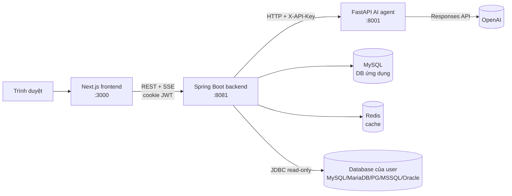

# KLTN – AI Text-to-SQL

KLTN là ứng dụng hỏi đáp dữ liệu bằng ngôn ngữ tự nhiên. Người dùng đăng nhập, khai báo các database được phép truy cập (MySQL, MariaDB, PostgreSQL, SQL Server, Oracle), đồng bộ schema, tạo cuộc hội thoại và đặt câu hỏi. Một AI agent tự khám phá schema, sinh câu SQL **chỉ đọc**, backend kiểm tra an toàn rồi thực thi, sau đó AI phân tích kết quả, đề xuất biểu đồ và lưu toàn bộ lịch sử.

> Tài liệu chi tiết nằm trong thư mục [`docs/`](docs/):
>
> | Tài liệu | Nội dung |
> |---|---|
> | [`docs/architecture.md`](docs/architecture.md) | Kiến trúc, agent loop, streaming SSE, cache, bảo mật |
> | [`docs/api.md`](docs/api.md) | Tham chiếu đầy đủ REST API của backend và agent |
> | [`docs/database.md`](docs/database.md) | Schema ứng dụng, trạng thái, catalog `db_engines`, Flyway |
> | [`agent/README.md`](agent/README.md) | Dịch vụ AI agent (FastAPI + OpenAI) |
> | [`text-to-sql-agent/README.md`](text-to-sql-agent/README.md) | Frontend Next.js |
> | [`AGENTS.md`](AGENTS.md) | Quy tắc nghiệp vụ và quy tắc cộng tác cho người/AI sửa code |

---

## 1. Tính năng

**Tài khoản**

- Đăng ký, đăng nhập bằng JWT lưu trong cookie `access_cookie`, xem/sửa/xóa tài khoản.

**Data source**

- CRUD data source theo ownership; tên data source unique trong phạm vi một user.
- Hỗ trợ 5 engine: MySQL, MariaDB, PostgreSQL, SQL Server, Oracle. Cách kết nối từng engine được lưu dưới dạng dữ liệu trong bảng `db_engines`, không hard-code.
- Cấu hình riêng mỗi data source: schema, SSL, connect timeout, query timeout, số dòng tối đa, thuộc tính JDBC bổ sung (có danh sách chặn thuộc tính nguy hiểm).
- Test kết nối cho cấu hình đã lưu hoặc **chưa lưu** (form nháp).
- Đồng bộ schema (tên bảng/view, cột, kiểu dữ liệu, nullable) thành snapshot JSON; không đọc dữ liệu thật.
- Xóa = archive (soft delete); lịch sử hội thoại vẫn đọc được.

**Hội thoại và AI agent**

- Mỗi conversation gắn với đúng một data source.
- Agent loop nhiều bước: AI có thể gọi tool `describe_table`, `sample_values`, `run_sql` (xem trước 20 dòng) trước khi chốt SQL cuối.
- Tự sửa lỗi: SQL lỗi/không an toàn được gửi lại cho AI kèm thông báo lỗi; agent mất kết nối được retry với backoff.
- Streaming tiến trình qua Server-Sent Events (`thought`, `observation`, `retry`, `result`, `error`).
- AI đánh giá kết quả: tóm tắt, các điểm nổi bật và đề xuất biểu đồ (`table`, `bar`, `line`, `pie`, `number`).
- Feedback 👍/👎 cho câu trả lời; các cặp câu hỏi → SQL được 👍 trở thành few-shot example cho các câu hỏi sau trên cùng data source.
- Có endpoint chạy SQL thủ công (read-only) trong conversation.

**Vận hành**

- Redis cache kết quả query và ngữ cảnh hội thoại (best-effort: Redis lỗi thì bỏ qua).
- Flyway migration cho schema ứng dụng.
- Docker Compose dựng đủ MySQL, Redis, backend, agent, frontend.

---

## 2. Kiến trúc tổng quan



Nguyên tắc phân tách trách nhiệm:

- **Agent không bao giờ kết nối database của user.** Agent chỉ nhận schema + kết quả tool do backend gửi và trả về quyết định (gọi tool nào / SQL cuối). Agent là stateless.
- **Backend là nơi duy nhất chạm vào database của user**: kiểm tra ownership, validate SQL, mở kết nối read-only, giới hạn dòng/timeout, lưu lịch sử.
- **Frontend** chỉ gọi backend; không biết địa chỉ agent.

Chi tiết xem [`docs/architecture.md`](docs/architecture.md).

---

## 3. Cấu trúc repository

```text
KLTN/
├── README.md                    Tài liệu tổng quan (file này)
├── AGENTS.md                    Quy tắc nghiệp vụ & cộng tác
├── docker-compose.yml           Môi trường chạy đầy đủ 5 service
├── docs/                        Tài liệu chi tiết (kiến trúc, API, database)
├── backend/ai_agent/            Spring Boot 4.1 / Java 21
│   ├── src/main/java/com/backend/ai_agent/
│   │   ├── controller/          REST API (auth, user, data source, db engine, conversation)
│   │   ├── service/             Nghiệp vụ, agent loop, JDBC, cache, SQL safety
│   │   ├── repository/          Spring Data JPA
│   │   ├── entity/              JPA entity
│   │   ├── dto/request|response Contract API
│   │   ├── security/            AuthFilter (đọc cookie JWT), JwtUtils
│   │   ├── config/              Spring Security, CORS
│   │   └── exception/           Exception nghiệp vụ + GlobalExceptionHandler
│   ├── src/main/resources/
│   │   ├── application.yml      Cấu hình chạy thật (MySQL + Redis)
│   │   ├── application-test.yml Cấu hình test (H2, tắt Flyway)
│   │   └── db/migration/        Flyway V1 → V7
│   └── src/test/                Unit/integration test
├── agent/                       FastAPI AI agent (Python 3.12)
│   ├── app/                     main.py, provider.py, models.py, sql_safety.py, ...
│   ├── tests/                   pytest
│   └── .env.example
├── text-to-sql-agent/           Next.js 16 / React 19 frontend
└── script/
    ├── intit.txt                Lệnh chạy nhanh 3 service khi dev
    └── test-questions-rfam.md   Bộ câu hỏi kiểm thử với DB công khai Rfam
```

---

## 4. Chạy nhanh bằng Docker Compose

Yêu cầu: Docker Engine/Desktop có Compose v2, một OpenAI API key.

```bash
# 1. Tạo file env cho agent (bắt buộc – compose đọc ./agent/.env)
cp agent/.env.example agent/.env
#    rồi sửa OPENAI_API_KEY=sk-... trong agent/.env

# 2. Build và chạy
docker compose up --build
```

| Service | Container | Địa chỉ từ host |
|---|---|---|
| Frontend | `ai_agent_frontend` | <http://localhost:3000> |
| Backend | `ai_agent_backend` | <http://localhost:8081> |
| AI agent | `ai_agent_rules` | <http://localhost:8001> (Swagger: `/docs`) |
| MySQL (DB ứng dụng) | `mysql_agent` | `localhost:3308`, user `root`, DB `ai_agent` |
| Redis | `redis_agent` | `localhost:6379` |

Backend chờ MySQL và Redis healthy rồi mới khởi động; Flyway tự tạo schema khi backend start.

```bash
docker compose logs -f backend   # xem log một service
docker compose down              # dừng, giữ dữ liệu
docker compose down -v           # dừng và XÓA volume MySQL/Redis
```

Chỉ dùng `down -v` khi chắc chắn không cần dữ liệu local.

### Biến môi trường của Compose

Đặt trong shell hoặc file `.env` ở thư mục gốc (Compose tự đọc).

| Biến | Mặc định | Ý nghĩa |
|---|---|---|
| `MYSQL_ROOT_PASSWORD` | `1234` | Mật khẩu root MySQL ứng dụng |
| `MYSQL_PORT` | `3308` | Port MySQL publish ra host |
| `REDIS_PORT` | `6379` | Port Redis publish ra host |
| `BACKEND_PORT` | `8081` | Port backend publish ra host |
| `AGENT_PORT` | `8001` | Port agent publish ra host |
| `FRONTEND_PORT` | `3000` | Port frontend publish ra host |
| `NEXT_PUBLIC_API_URL` | `http://localhost:8081` | URL backend mà **trình duyệt** gọi (nhúng lúc build image) |
| `QUERY_CACHE_TTL_SECONDS` | `60` | TTL cache kết quả query và ngữ cảnh hội thoại |
| `AGENT_BASE_URL` | `http://agent:8001` | URL backend dùng để gọi agent |
| `AGENT_API_KEY` | `mock-ai-agent-key` | Shared key giữa backend và agent (header `X-API-Key`) |
| `AGENT_CORS_ORIGINS` | `http://localhost:3000` | CORS origin của agent |

Biến của OpenAI (`OPENAI_API_KEY`, `OPENAI_MODEL`, ...) nằm trong `agent/.env`, xem [mục 6](#6-cấu-hình).

Ví dụ: `QUERY_CACHE_TTL_SECONDS=120 BACKEND_PORT=9090 NEXT_PUBLIC_API_URL=http://localhost:9090 docker compose up --build`.

> Đổi `NEXT_PUBLIC_API_URL` phải build lại image frontend vì biến này được nhúng vào bundle lúc build. Nếu đổi origin của frontend, cũng phải thêm origin đó vào CORS của backend (`SecurityConfig`), hiện chỉ cho phép `http://localhost:3000` và `http://localhost:5173`.

---

## 5. Chạy local (không Docker) để phát triển

Yêu cầu: Java 21 + Maven, Python 3.12, Node.js 22 + npm, MySQL 8 và Redis.

### 5.1. Hạ tầng

Cách nhanh nhất là chỉ bật MySQL và Redis bằng Compose:

```bash
docker compose up -d mysql-db redis
```

Backend mặc định kết nối `jdbc:mysql://localhost:3308/ai_agent` với `root` / `1234` (xem `backend/ai_agent/src/main/resources/application.yml`).

### 5.2. AI agent (port 8001)

```bash
cd agent
python3 -m venv .venv
source .venv/bin/activate
pip install -r requirements.txt
cp .env.example .env        # điền OPENAI_API_KEY
uvicorn app.main:app --reload --port 8001 --ws websockets
```

Kiểm tra: `curl http://localhost:8001/health` → `{"status":"ok","provider":"openai"}`.

### 5.3. Backend (port 8081)

```bash
cd backend/ai_agent
mvn spring-boot:run          # hoặc ./mvnw spring-boot:run
```

Ghi đè cấu hình bằng biến môi trường khi cần, ví dụ:

```bash
AGENT_BASE_URL=http://localhost:8001 AGENT_MAX_STEPS=10 mvn spring-boot:run
SPRING_DATASOURCE_URL='jdbc:mysql://localhost:3306/ai_agent?useSSL=false&serverTimezone=UTC&allowPublicKeyRetrieval=true' \
SPRING_DATASOURCE_PASSWORD=secret mvn spring-boot:run
```

Kết hợp hỗn hợp:

| Backend chạy ở | Agent chạy ở | `AGENT_BASE_URL` |
|---|---|---|
| Host | Host | `http://localhost:8001` (mặc định) |
| Compose | Compose | `http://agent:8001` (mặc định của Compose) |
| Compose | Host | `http://host.docker.internal:8001` |

### 5.4. Frontend (port 3000)

```bash
cd text-to-sql-agent
npm ci
npm run dev                  # NEXT_PUBLIC_API_URL mặc định http://localhost:8081
```

Mở <http://localhost:3000>, đăng ký tài khoản, đăng nhập.

### 5.5. Thử nhanh với database công khai

`script/test-questions-rfam.md` dùng database Rfam công khai (MySQL `mysql-rfam-public.ebi.ac.uk:4497`, DB `Rfam`, user `rfamro`, không mật khẩu) và có sẵn bộ câu hỏi kèm đáp án tham chiếu để đánh giá chất lượng agent.

Luồng sử dụng:

1. Đăng ký và đăng nhập.
2. Thêm data source → **Test kết nối** → Lưu.
3. **Đồng bộ schema** (bắt buộc: agent chỉ biết những bảng có trong snapshot).
4. Tạo conversation với data source đó.
5. Đặt câu hỏi, theo dõi các bước của agent, xem bảng/biểu đồ/phân tích.
6. Đánh giá 👍 cho câu trả lời đúng để agent học theo.

---

## 6. Cấu hình

### Backend (`application.yml`)

| Thuộc tính | Biến môi trường | Mặc định | Ý nghĩa |
|---|---|---|---|
| `server.port` | `SERVER_PORT` | `8081` | Port HTTP |
| `spring.datasource.url` | `SPRING_DATASOURCE_URL` | `jdbc:mysql://localhost:3308/ai_agent?...` | DB ứng dụng |
| `spring.datasource.username` | `SPRING_DATASOURCE_USERNAME` | `root` | |
| `spring.datasource.password` | `SPRING_DATASOURCE_PASSWORD` | `1234` | |
| `spring.data.redis.host` | `REDIS_HOST` | `localhost` | |
| `spring.data.redis.port` | `REDIS_PORT` | `6379` | |
| `app.agent.base-url` | `AGENT_BASE_URL` | `http://localhost:8001` | URL agent |
| `app.agent.api-key` | `AGENT_API_KEY` | `mock-ai-agent-key` | Gửi trong header `X-API-Key` |
| `app.agent.max-steps` | `AGENT_MAX_STEPS` | `8` (tối thiểu 2) | Số bước tối đa của agent loop mỗi câu hỏi |
| `app.agent.max-retries` | `AGENT_MAX_RETRIES` | `3` | Số lần lỗi (agent/tool/SQL) cho phép trước khi bỏ cuộc |
| `app.cache.query-ttl-seconds` | `QUERY_CACHE_TTL_SECONDS` | `60` | TTL Redis |

JPA chạy `ddl-auto: validate` – schema do Flyway quản lý, entity phải khớp migration.

### Agent (`agent/.env`)

| Biến | Mặc định | Ý nghĩa |
|---|---|---|
| `OPENAI_API_KEY` | trống | Key OpenAI. **Trống ⇒ agent dùng `MockAgentProvider`** (chỉ sinh `SELECT COUNT(*)`), dùng cho test |
| `OPENAI_MODEL` | `gpt-4o-mini` | Model; với `gpt-5*`, `o1`, `o3`, `o4` agent gửi thêm tham số reasoning |
| `AI_TIMEOUT` | `60` | Timeout (giây) mỗi lần gọi OpenAI |
| `AI_MAX_TOKENS` | `1200` | `max_output_tokens` lần gọi đầu |
| `AI_RETRY_MAX_TOKENS` | `2048` | Budget khi tự gọi lại do output bị cắt |
| `AI_REASONING_EFFORT` | `low` | Reasoning effort cho reasoning model |
| `AGENT_API_KEY` | `mock-ai-agent-key` | Phải trùng với backend |
| `AGENT_CORS_ORIGINS` | `http://localhost:3000` | Danh sách origin, phân tách bằng dấu phẩy |
| `AGENT_CACHE_TTL_SECONDS` | `300` | TTL cache in-process của `/v1/agent/generate-sql` |

### Frontend

| Biến | Mặc định | Ý nghĩa |
|---|---|---|
| `NEXT_PUBLIC_API_URL` | `http://localhost:8081` | URL backend; nhúng vào bundle lúc build |

> Không commit file `.env` chứa key thật. `.gitignore` đã bỏ qua `*.env`.

---

## 7. Tóm tắt API

Tất cả endpoint có tiền tố `/v1`. Trừ `POST /v1/auth/login` và `POST /v1/user/create_user`, mọi request phải kèm cookie `access_cookie`.

| Nhóm | Endpoint chính |
|---|---|
| Auth/User | `POST /v1/auth/login`, `POST /v1/user/create_user`, `GET/PUT/DELETE /v1/user/me`, `POST /logout` |
| Engine | `GET /v1/db-engines` |
| Data source | `POST/GET /v1/data-sources`, `GET/PUT/DELETE /v1/data-sources/{id}`, `POST /v1/data-sources/{id}/test-connection`, `POST /v1/data-sources/test-connection?sourceId=`, `POST /v1/data-sources/{id}/sync-schema` |
| Conversation | `POST/GET /v1/conversations`, `GET/PATCH/DELETE /v1/conversations/{id}` |
| Chat | `GET/POST /v1/conversations/{id}/messages`, `POST /v1/conversations/{id}/messages/stream` (SSE), `POST /v1/conversations/{id}/messages/{messageId}/feedback` |
| Query thủ công | `POST /v1/conversations/{id}/query` |

Request/response chi tiết, mã lỗi và ví dụ `curl`: [`docs/api.md`](docs/api.md).

---

## 8. Kiểm thử

```bash
# Backend – dùng profile test (H2 in-memory, tắt Flyway), không cần MySQL/Redis
cd backend/ai_agent && mvn clean test

# Agent
cd agent && source .venv/bin/activate && pytest

# Frontend
cd text-to-sql-agent && npm run lint && npm run build
```

| Bộ test | Nội dung |
|---|---|
| `AiAgentApplicationTests` | Application context khởi động được |
| `SqlSafetyValidatorTest` | Cho phép `SELECT`/`WITH`; chặn mutation, DDL, multi-statement, comment, hàm nguy hiểm theo engine |
| `JdbcConnectionFactoryTest` | Build URL/properties từ catalog; chặn ghi đè credential và thuộc tính JDBC nguy hiểm; quote identifier; row limit theo engine; chặn host/database có thể inject tham số URL |
| `ConversationServiceAgentLoopTest` | Retry khi agent không truy cập được; feed SQL lỗi lại cho agent; chặn SQL không an toàn và bỏ cuộc sau `max-retries` |
| `agent/tests/test_agent.py` | `/health` không cần key; endpoint cần `X-API-Key`; SQL sinh ra là read-only; vòng `step` gọi tool rồi kết thúc; `final` bắt buộc có SQL |

Kiểm tra end-to-end thủ công bằng bộ câu hỏi `script/test-questions-rfam.md`.

---

## 9. Bảo mật – tóm tắt

- Ownership: mọi truy vấn tài nguyên dùng `userId` lấy từ JWT (`findByIdAndUserId`, `findByIdAndOwnerId`), không tin id do client gửi.
- SQL read-only được kiểm tra **hai lớp** (agent và backend) + `Connection.setReadOnly(true)` + `setMaxRows` + `setQueryTimeout`.
- Password data source không bao giờ có trong response; thông báo lỗi chứa `password=` bị che.
- Thuộc tính JDBC tùy chỉnh không được ghi đè `user`/`password`/host/port và không được chứa các từ khóa nguy hiểm (`factory`, `interceptor`, `deserializ`, `infile`, ...).
- Agent được bảo vệ bằng `X-API-Key`; prompt, response thô và key OpenAI không bị trả ra ngoài.

Chi tiết và các giới hạn đã biết: [`docs/architecture.md#7-bảo-mật`](docs/architecture.md#7-bảo-mật).

---

## 10. Hạn chế đã biết và hướng phát triển

Hạn chế hiện tại (đã đối chiếu với code):

1. **JWT secret sinh ngẫu nhiên mỗi lần backend khởi động** (`Jwts.SIG.HS512.key()`), nên restart backend làm mọi phiên đăng nhập mất hiệu lực và không chạy được nhiều instance. Cookie sống 60 phút, token hết hạn sau 10 giờ.
2. Cookie `access_cookie` đang `httpOnly(false)` và không `Secure`.
3. Password data source lưu **plain text** trong cột `data_sources.password`; cần mã hóa ở application layer hoặc dùng secret manager.
4. Status `BLOCKED` của query execution và `CONNECTION_ERROR`/`SYNCING` của data source đã được dự kiến nhưng chưa được set ở đâu: SQL không an toàn bị từ chối trước khi tạo bản ghi.
5. Xóa user (`DELETE /v1/user/me`) sẽ lỗi 500 nếu user còn data source (FK `ON DELETE RESTRICT`).
6. Chưa có pagination cho danh sách conversation/message/data source; chưa có API xem lịch sử query execution riêng.
7. CORS backend hard-code `localhost:3000` và `localhost:5173`.
8. Thư mục virtualenv `agent/agent/` đang bị commit vào git; nên xóa khỏi repo và thêm vào `.gitignore`.

Hướng phát triển:

1. Cấu hình JWT secret qua biến môi trường, bật `httpOnly`/`Secure` cho cookie.
2. Mã hóa password data source; khuyến nghị dùng tài khoản DB read-only riêng cho mỗi data source.
3. Ghi nhận `BLOCKED` vào `query_executions` để audit.
4. Pagination, API lịch sử query, giới hạn kích thước `result_json`.
5. Integration test với Testcontainers cho từng engine.
6. Schema versioning khi database ngoài thay đổi thường xuyên.
