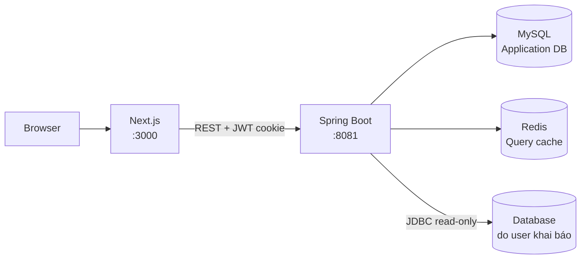
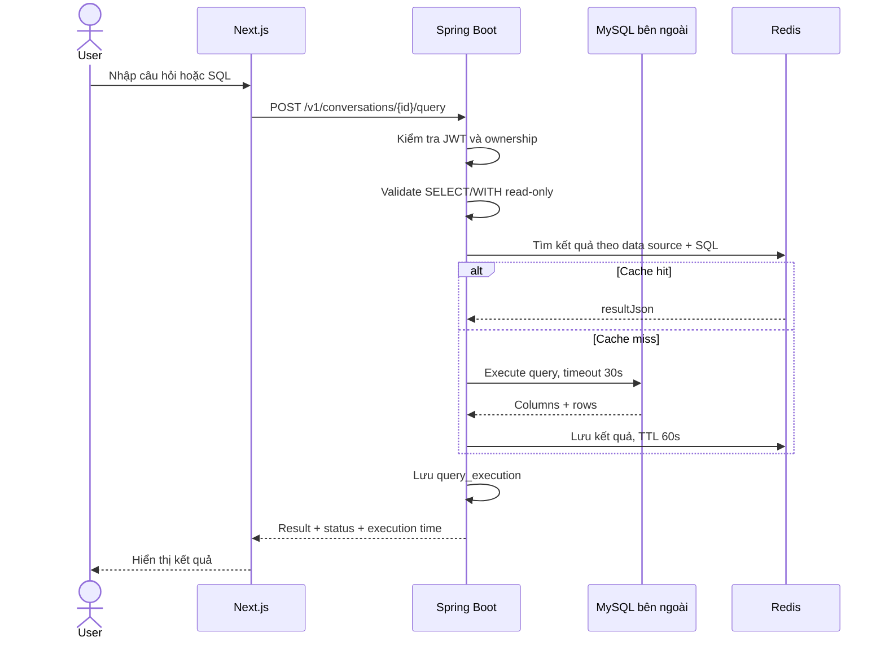
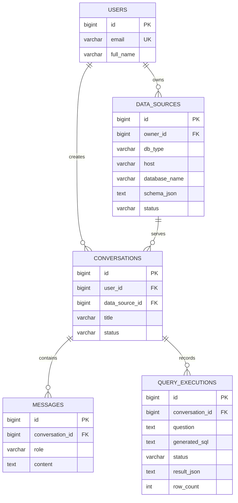
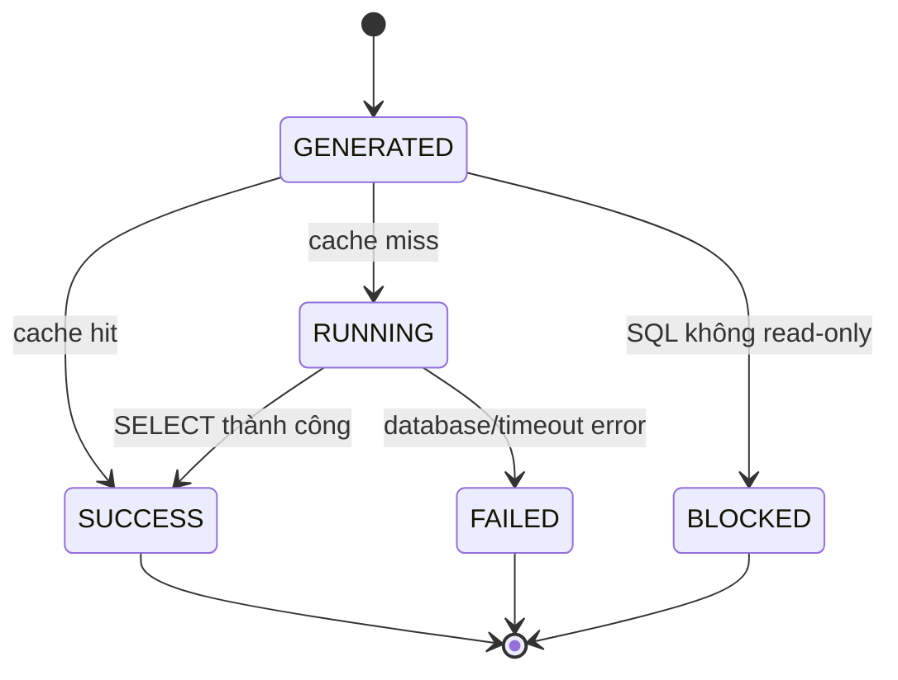

# KLTN – AI Text-to-SQL

KLTN là ứng dụng cho phép người dùng đăng nhập, khai báo database được phép truy cập, đồng bộ schema, tạo conversation và thực thi các truy vấn đọc dữ liệu.

## Trạng thái hiện tại

Đã có:

- Đăng ký, đăng nhập bằng JWT cookie và quản lý user.
- CRUD data source MySQL theo ownership của user.
- Kiểm tra kết nối và đồng bộ schema database bên ngoài.
- CRUD conversation, message và archive tài nguyên.
- Thực thi SQL read-only và lưu lịch sử query execution.
- Redis cache cho kết quả query thành công.
- Docker Compose cho MySQL, Redis, backend và frontend.
- Test backend bằng H2 in-memory.

Chưa hoàn thiện:

- Backend chưa tự gọi LLM để chuyển câu hỏi tự nhiên thành SQL.
- `POST /v1/conversations/{id}/messages` hiện mới lưu user message; assistant message cần tích hợp AI provider.
- Chưa có pagination đầy đủ cho các danh sách.

## Kiến trúc

```text
Browser -> Next.js :3000 -> Spring Boot :8081 -> MySQL :3306
                                      |
                                      +-> Redis :6379

Spring Boot -> Database bên ngoài do user khai báo
```

### Kiến trúc triển khai



### Luồng nghiệp vụ chính



```text
backend/ai_agent/       Spring Boot API, JPA, Flyway, security, query execution
text-to-sql-agent/      Next.js frontend
docker-compose.yml      Môi trường chạy đầy đủ
AGENTS.md               Quy tắc cộng tác và nghiệp vụ của repository
```

Backend gồm `controller`, `service`, `repository`, `entity`, `dto`, `security`, `config`, `exception` và `src/main/resources/db/migration`.

## Chạy bằng Docker

Yêu cầu Docker Engine/Desktop có Docker Compose. Từ thư mục gốc:

```bash
docker compose up --build
```

Địa chỉ mặc định:

- Frontend: <http://localhost:3000>
- Backend: <http://localhost:8081>
- MySQL từ host: `localhost:3308`
- Redis từ host: `localhost:6379`

Dừng container:

```bash
docker compose down
```

Xóa cả dữ liệu development:

```bash
docker compose down -v
```

Chỉ dùng `down -v` khi chắc chắn không cần dữ liệu local nữa.

| Biến | Mặc định | Ý nghĩa |
|---|---:|---|
| `MYSQL_ROOT_PASSWORD` | `1234` | Mật khẩu root MySQL |
| `MYSQL_PORT` | `3308` | Port MySQL trên host |
| `REDIS_PORT` | `6379` | Port Redis trên host |
| `BACKEND_PORT` | `8081` | Port backend trên host |
| `FRONTEND_PORT` | `3000` | Port frontend trên host |
| `NEXT_PUBLIC_API_URL` | `http://localhost:8081` | Backend URL của frontend |
| `QUERY_CACHE_TTL_SECONDS` | `60` | TTL cache query và context conversation |
| `AGENT_BASE_URL` | `http://localhost:8001` | URL FastAPI OpenAI agent |
| `AGENT_API_KEY` | `mock-ai-agent-key` | Shared key giữa backend và agent |
| `OPENAI_API_KEY` | — | API key được agent dùng để gọi OpenAI |
| `OPENAI_MODEL` | `gpt-4o-mini` | Model sinh kế hoạch SQL có cấu trúc |

Khi chạy backend ngoài Docker, dùng `AGENT_BASE_URL=http://localhost:8001`. Khi chạy cả backend và agent bằng Compose, mặc định dùng `http://agent:8001`. Nếu backend ở Docker nhưng agent chạy trên host, dùng `AGENT_BASE_URL=http://host.docker.internal:8001`.

Ví dụ:

```bash
QUERY_CACHE_TTL_SECONDS=120 docker compose up --build
```

## Chạy local không dùng Docker

### Backend

Yêu cầu Java 21, Maven và MySQL ở `localhost:3308`.

```bash
cd backend/ai_agent
mvn spring-boot:run
```

Backend dùng Flyway để tạo/cập nhật schema ứng dụng.

### Frontend

Yêu cầu Node.js và npm.

```bash
cd text-to-sql-agent
npm ci
npm run dev
```

Nếu backend chạy ở địa chỉ khác:

```bash
NEXT_PUBLIC_API_URL=http://localhost:8081 npm run dev
```

## API

Các endpoint dưới đây, trừ endpoint public, yêu cầu JWT cookie sau khi đăng nhập.

### Authentication và user

| Method | Endpoint | Mô tả |
|---|---|---|
| `POST` | `/v1/user/create_user` | Tạo user |
| `POST` | `/v1/auth/login` | Đăng nhập và set cookie |
| `GET` | `/v1/user/me` | Lấy user hiện tại |
| `PUT` | `/v1/user/me` | Cập nhật user hiện tại |
| `DELETE` | `/v1/user/me` | Xóa user hiện tại |

### Data source

| Method | Endpoint | Mô tả |
|---|---|---|
| `POST` | `/v1/data-sources` | Tạo data source |
| `GET` | `/v1/data-sources` | Liệt kê data source của user |
| `GET` | `/v1/data-sources/{id}` | Xem data source |
| `PUT` | `/v1/data-sources/{id}` | Cập nhật data source |
| `DELETE` | `/v1/data-sources/{id}` | Archive data source |
| `POST` | `/v1/data-sources/{id}/test-connection` | Kiểm tra kết nối |
| `POST` | `/v1/data-sources/{id}/sync-schema` | Đồng bộ schema |

`test-connection` chỉ kiểm tra kết nối. `sync-schema` đọc tên bảng, tên cột, kiểu dữ liệu và nullable; không đọc các dòng dữ liệu.

### Conversation và query

| Method | Endpoint | Mô tả |
|---|---|---|
| `POST` | `/v1/conversations` | Tạo conversation với một data source |
| `GET` | `/v1/conversations` | Liệt kê conversation |
| `GET` | `/v1/conversations/{id}` | Xem conversation |
| `PATCH` | `/v1/conversations/{id}` | Đổi title |
| `DELETE` | `/v1/conversations/{id}` | Archive conversation |
| `GET` | `/v1/conversations/{id}/messages` | Lấy lịch sử messages |
| `POST` | `/v1/conversations/{id}/messages` | Gọi agent, chạy SQL read-only, lưu USER/ASSISTANT và trả chart metadata |
| `POST` | `/v1/conversations/{id}/query` | Thực thi SQL read-only |

Request mẫu:

```json
{
  "question": "Lấy 10 người dùng đầu tiên",
  "sql": "SELECT * FROM users LIMIT 10"
}
```

SQL phải là một câu `SELECT` hoặc `WITH`. Backend chặn mutation, DDL, multi-statement và comment nguy hiểm. Mỗi query timeout sau 30 giây và trả tối đa 1.000 dòng.

## Redis cache

Cache được dùng cho query chạy thành công trong `QueryExecutionService`.

- Key là SHA-256 của data source và SQL.
- Giá trị gồm `resultJson` và `rowCount`.
- TTL mặc định 60 giây, cấu hình bằng `QUERY_CACHE_TTL_SECONDS`.
- Redis lỗi thì backend bỏ qua cache và truy vấn database trực tiếp.
- Không cache password, connection URL hoặc credentials.

## Database và migration

```text
users 1 --- N data_sources
users 1 --- N conversations
data_sources 1 --- N conversations
conversations 1 --- N messages
conversations 1 --- N query_executions
```



### Trạng thái query execution



Migration hiện có:

- `V1__create_primary_tables.sql`: data sources, conversations, messages, query executions.
- `V2__create_users.sql`: users.
- `V3__alter_data_conversations.sql`: ownership, status và foreign key.
- `V4__rename_conversation_status.sql`: điều chỉnh status conversation.

Không sửa migration đã chạy trên database dùng chung. Khi thay đổi schema, tạo migration version mới trước rồi cập nhật entity.

## Test và kiểm tra

Backend dùng profile `test`, H2 in-memory và không cần MySQL/Redis thật:

```bash
cd backend/ai_agent
mvn clean test
```

Test hiện kiểm tra application context và SQL safety (`SELECT`, `WITH`, mutation, multi-statement, comment nguy hiểm).

Frontend:

```bash
cd text-to-sql-agent
npm run lint
npm run build
```

## Bảo mật và vận hành

- Mọi tài nguyên phải được truy vấn theo user hiện tại từ JWT.
- Không tin `user_id`, `owner_id`, status hoặc generated SQL do client gửi.
- Không trả password trong response và không log credentials.
- Chỉ chạy SQL read-only trên database bên ngoài.
- Không chạy `flyway clean`, reset database hoặc xóa volume production nếu chưa được xác nhận.
- Password data source hiện cần được mã hóa ở application-layer hoặc quản lý bằng secret manager khi triển khai production.

## Hướng phát triển

1. Tích hợp LLM để sinh SQL từ câu hỏi tự nhiên và schema snapshot.
2. Lưu assistant message trong cùng chat flow.
3. Bổ sung API query execution history và pagination.
4. Thêm giới hạn kích thước JSON, audit log và integration test bằng Testcontainers.
5. Dùng read-only credentials riêng cho từng data source.
