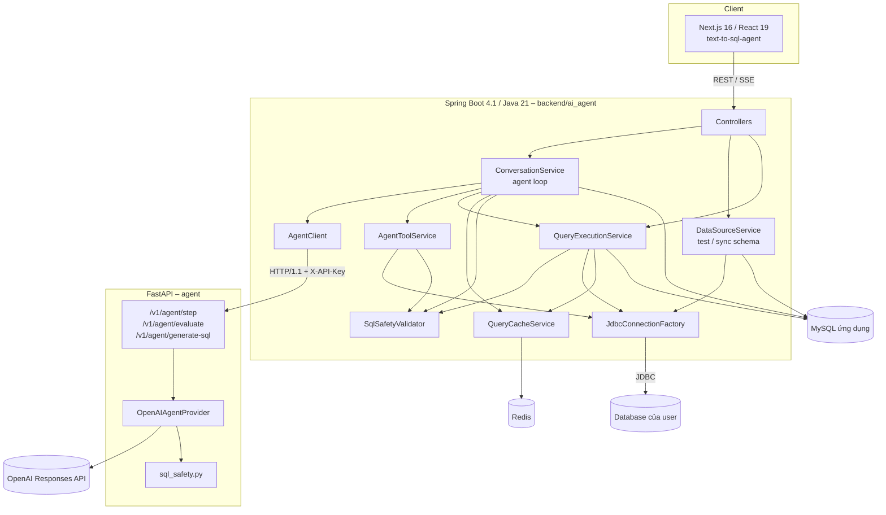
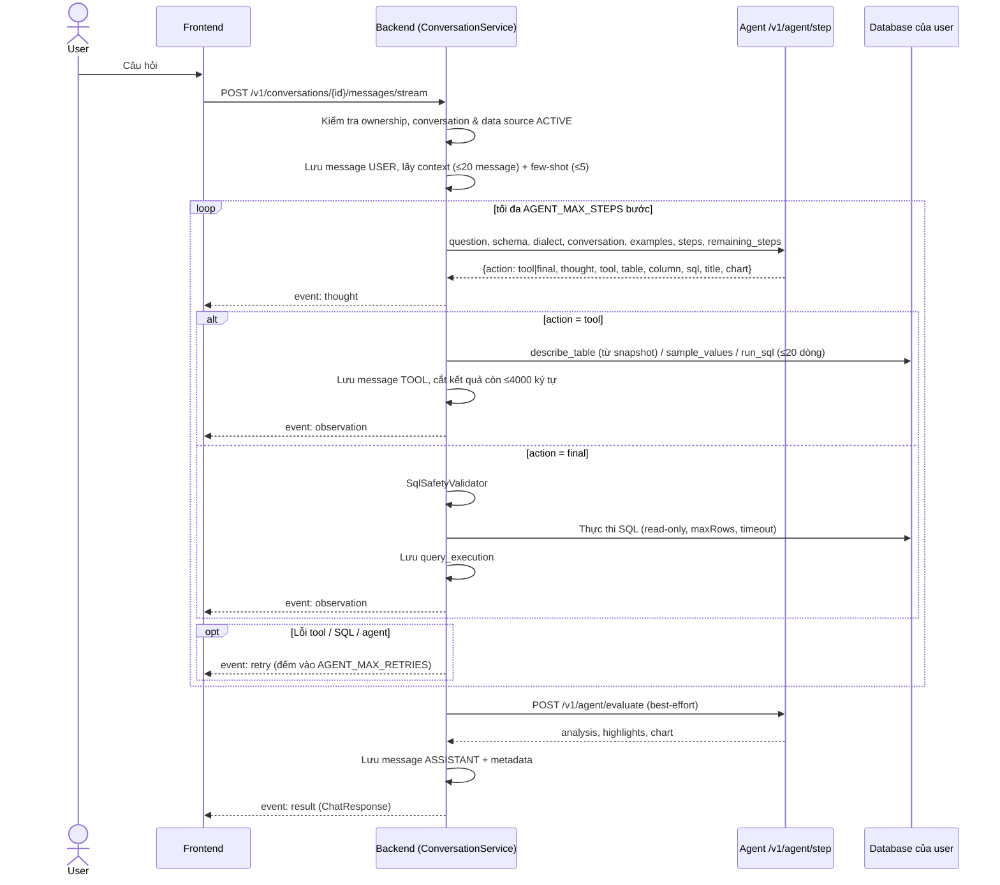
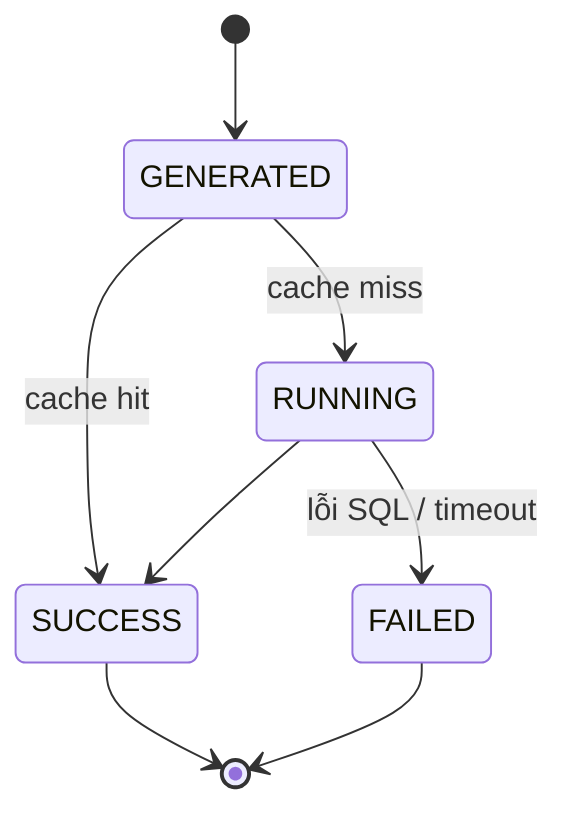

# Kiến trúc hệ thống

Tài liệu này mô tả các thành phần, luồng xử lý chính và các cơ chế an toàn của KLTN. Xem [`../README.md`](../README.md) để biết cách chạy, [`api.md`](api.md) cho API và [`database.md`](database.md) cho schema.

## Mục lục

1. [Thành phần](#1-thành-phần)
2. [Luồng nghiệp vụ tổng thể](#2-luồng-nghiệp-vụ-tổng-thể)
3. [Agent loop](#3-agent-loop)
4. [Streaming tiến trình (SSE)](#4-streaming-tiến-trình-sse)
5. [Đánh giá kết quả và few-shot memory](#5-đánh-giá-kết-quả-và-few-shot-memory)
6. [Kết nối đa engine và thực thi query](#6-kết-nối-đa-engine-và-thực-thi-query)
7. [Bảo mật](#7-bảo-mật)
8. [Cache](#8-cache)
9. [Xử lý lỗi](#9-xử-lý-lỗi)

---

## 1. Thành phần



| Thành phần | Công nghệ | Trách nhiệm |
|---|---|---|
| Frontend `text-to-sql-agent/` | Next.js 16, React 19, Tailwind 4, Recharts | Đăng nhập, quản lý data source, workspace chat, hiển thị bảng/biểu đồ, timeline các bước agent, feedback |
| Backend `backend/ai_agent/` | Spring Boot 4.1, Spring Security, JPA/Hibernate, Flyway, Redis, JJWT | Xác thực, ownership, lưu trữ, điều phối agent loop, thực thi tool và SQL trên DB của user, cache |
| Agent `agent/` | FastAPI, Pydantic v2, OpenAI SDK | Gọi LLM với Structured Outputs để quyết định bước tiếp theo, sinh SQL, đánh giá kết quả. Stateless, không kết nối DB của user |
| MySQL 8 | | DB ứng dụng: users, data sources, conversations, messages, query executions, feedback, db engines |
| Redis 7 | | Cache kết quả query và ngữ cảnh hội thoại |

### Các class quan trọng ở backend

| Class | Vai trò |
|---|---|
| `security/AuthFilter` | Đọc cookie `access_cookie`, validate JWT, đặt `Authentication` với principal là `userId` |
| `security/JwtUtils` | Sinh/kiểm tra JWT HS512 (claim `userId`, subject = email, issuer `Niendz`) |
| `config/SecurityConfig` | Stateless, tắt CSRF/form login, CORS, cho phép public `/v1/auth/**` và `/v1/user/create_user`, logout `/logout` |
| `service/ConversationService` | CRUD conversation, **agent loop**, lưu message USER/TOOL/ASSISTANT, feedback |
| `service/AgentClient` | HTTP client tới agent (`step`, `evaluate`, `generate`). Ép HTTP/1.1 vì uvicorn từ chối h2c upgrade |
| `service/AgentToolService` | Thực thi tool `describe_table`, `sample_values`, `run_sql` (≤ 20 dòng, ≤ 15 giây) |
| `service/QueryExecutionService` | Thực thi SQL cuối, ghi `query_executions`, dùng cache |
| `service/SqlSafetyValidator` | Kiểm tra SQL read-only phía backend |
| `service/JdbcConnectionFactory` | Mở kết nối JDBC theo catalog `db_engines`, quote identifier, row limit theo engine, lọc thuộc tính JDBC |
| `service/DataSourceService` | CRUD data source, test kết nối, đồng bộ schema |
| `service/QueryCacheService` | Redis cache best-effort |
| `exception/GlobalExceptionHandler` | Chuyển exception nghiệp vụ thành `ApiError` JSON thống nhất |

---

## 2. Luồng nghiệp vụ tổng thể

```text
Đăng ký / đăng nhập
  → Tạo data source (có thể test kết nối nháp trước khi lưu)
  → Đồng bộ schema (lưu snapshot JSON vào data_sources.schema_json)
  → Tạo conversation gắn với data source ACTIVE
  → Gửi câu hỏi
      → lưu message USER
      → agent loop: AI chọn tool → backend chạy tool → gửi kết quả lại → ... → AI trả SQL cuối
      → backend validate + chạy SQL cuối, lưu query_execution
      → AI đánh giá kết quả, đề xuất biểu đồ
      → lưu message ASSISTANT (metadata: SQL, chart, evaluation, highlights, queryId)
  → Người dùng feedback UP/DOWN → câu UP thành few-shot cho lần sau
```

---

## 3. Agent loop

Agent loop nằm ở `ConversationService.chat(...)`. Backend giữ trạng thái (danh sách `steps`), agent chỉ nhận toàn bộ lịch sử bước mỗi lần gọi và trả về **một** quyết định.



### 3.1. Tool của agent

| Tool | Tham số | Thực thi ở backend | Kết quả trả cho agent |
|---|---|---|---|
| `describe_table` | `table` | Đọc từ schema snapshot, không truy cập DB | Danh sách cột `{name, type, nullable}` |
| `sample_values` | `table`, `column` | `SELECT DISTINCT <col> AS sample_value FROM <table> WHERE <col> IS NOT NULL` + row limit 20 theo engine. Bảng/cột phải có trong snapshot và qua kiểm tra identifier | Tối đa 20 giá trị thật |
| `run_sql` | `sql` | Qua `SqlSafetyValidator`, chạy read-only, `maxRows=20`, timeout `min(15s, queryTimeout)` | `{columns, rows, rowCount}` |
| `final` (action) | `sql`, `title`, `chart` | Validate rồi chạy bằng `QueryExecutionService` với `maxRows`/`queryTimeout` của data source | Kết thúc loop nếu `SUCCESS` |

Prompt của agent (`agent/app/provider.py`, `_STEP_INSTRUCTIONS`) yêu cầu: chỉ dùng bảng/cột trong schema, kết thúc ngay nếu schema đủ rõ, đọc lỗi khi `ok=false` và không lặp lại lời gọi lỗi, dùng `sample_values` khi kết quả 0 dòng bất thường, bắt buộc `final` khi `remaining_steps = 1`, `thought` là một câu ngắn cùng ngôn ngữ với câu hỏi.

### 3.2. Tự sửa lỗi và giới hạn

| Tình huống | Xử lý |
|---|---|
| Agent không truy cập được / trả quyết định rỗng / lỗi 5xx | `AgentUnavailableException` → event `retry` → backoff `min(4s, 0.5s × 2^(n-1))` → gọi lại. Không tính là một bước |
| Tool lỗi (bảng/cột không tồn tại, SQL lỗi) | Bước được ghi với `ok=false` + `error`, gửi lại cho agent ở lần gọi sau; event `observation` (error) + `retry` |
| SQL cuối không an toàn hoặc chạy lỗi (`FAILED`) | Như trên; agent nhận lỗi và sinh lại SQL |
| Số lần lỗi vượt `AGENT_MAX_RETRIES` (mặc định 3) | Dừng, `400 "Agent vẫn gặp lỗi sau N lần thử lại: ..."` |
| Hết `AGENT_MAX_STEPS` (mặc định 8, tối thiểu 2) | Dừng, `400 "Agent không tìm được câu trả lời sau N bước: ..."` |

Ghi chú thiết kế: validate SQL cuối được làm trong `ConversationService.runFinal` **trước** khi gọi `QueryExecutionService.execute` (có `@Transactional`). Nếu để `BadRequestException` ném ra bên trong method transactional, transaction chat sẽ bị đánh dấu rollback-only dù đã catch. Vì lý do tương tự `AgentToolService` cố ý không transactional.

### 3.3. Message được lưu

Mỗi câu hỏi tạo ra chuỗi message append-only:

| Role | Khi nào | `content` | `metadata` (JSON) |
|---|---|---|---|
| `USER` | Đầu tiên | Câu hỏi (1–10.000 ký tự) | – |
| `TOOL` | Mỗi bước (kể cả `final_answer`) | `<tool>: <tóm tắt>` hoặc `<tool> lỗi: <lỗi>` | `step`, `tool`, `ok`, `args`, `thought` |
| `ASSISTANT` | Khi thành công | `<title>\n\n<sql>` | `title`, `sql`, `question`, `queryId`, `attempts`, `chart{type,x,y,title}`, `evaluation`, `highlights` |

Ngữ cảnh gửi cho agent chỉ gồm message `USER`/`ASSISTANT` (tối đa 20). Nếu agent loop thất bại, transaction chat bị rollback nên message USER/TOOL của lượt đó **không** được lưu.

### 3.4. Endpoint cũ `generate-sql`

`AgentClient.generate(...)` và endpoint agent `/v1/agent/generate-sql` (`/v1/agent/chat`) là luồng một phát (sinh SQL trực tiếp, có `previous_sql`/`error` để tự sửa). Backend hiện **không** dùng luồng này trong chat; luồng chat dùng `step`.

---

## 4. Streaming tiến trình (SSE)

`POST /v1/conversations/{id}/messages/stream` trả `text/event-stream`. Controller chạy agent loop trên virtual thread (`Executors.newVirtualThreadPerTaskExecutor()`), timeout emitter 5 phút. Frontend dùng `fetch` + `ReadableStream` (không dùng `EventSource` vì cần POST và cookie).

| Event | `data` | Ý nghĩa |
|---|---|---|
| `thought` | `{step, tool, message, args}` | Agent đã chọn hành động; `tool = final_answer` khi chốt SQL |
| `observation` | `{step, tool, status: "ok"\|"error", message}` | Kết quả tool hoặc SQL cuối |
| `retry` | `{attempt, maxAttempts, message, action}` | Có lỗi, đang thử lại |
| `result` | `ChatResponse` | Câu trả lời cuối, giống response của endpoint không stream |
| `error` | `{message}` | Thất bại. Lỗi không mong muốn được thay bằng thông báo chung |

Nếu client ngắt kết nối giữa chừng, loop vẫn chạy tiếp và câu trả lời vẫn được lưu. Security cho phép dispatcher `ASYNC` vì request gốc đã được xác thực.

---

## 5. Đánh giá kết quả và few-shot memory

**Evaluate.** Sau khi SQL cuối chạy thành công, backend gửi `question`, `sql`, `columns`, tối đa 1000 `rows` tới `/v1/agent/evaluate`; agent chỉ đưa 50 dòng đầu vào prompt. Kết quả gồm `analysis`, 2–5 `highlights` và `chart`. Bước này **best-effort**: lỗi thì `evaluation = null`, câu trả lời vẫn được lưu. Chart từ evaluate (dựa trên dữ liệu thật) được ưu tiên hơn chart agent đưa ra lúc chốt SQL.

**Few-shot memory.** Khi user gửi feedback `UP`, backend chụp `question` và `sql` từ metadata của message ASSISTANT vào `message_feedback`. Mỗi câu hỏi mới, backend lấy 5 feedback `UP` gần nhất **cùng data source** và gửi làm `examples`; agent đưa vào prompt dưới tên `accepted_examples` để bắt chước phong cách và quy ước cột.

---

## 6. Kết nối đa engine và thực thi query

`JdbcConnectionFactory` không hard-code engine; mọi khác biệt nằm trong bảng `db_engines` (xem [`database.md`](database.md#4-catalog-db_engines)):

1. Nạp driver `driver_class`; báo lỗi rõ nếu thiếu JAR.
2. Validate `host` (`[A-Za-z0-9._-]` hoặc IPv6 trong `[]`) và `database_name` (`[A-Za-z0-9_.$-]`) để chặn inject tham số vào URL.
3. Build URL từ `url_template` (`{host}`, `{port}`, `{database}`).
4. Properties theo thứ tự: `default_properties` → `ssl_properties` (nếu bật SSL) → thuộc tính timeout (`timeout_property`, đổi sang ms nếu `timeout_unit = MILLISECONDS`) → thuộc tính riêng của data source (được kiểm tra lại) → `user`/`password` (luôn đặt sau cùng nên không ghi đè được).
5. Nếu data source có `schema_name` và engine có `schema_init_sql` (PostgreSQL `SET search_path TO {schema}`, Oracle `ALTER SESSION SET CURRENT_SCHEMA = {schema}`), chạy câu này với tên schema đã quote.

Khi đồng bộ schema với engine không có `schema_init_sql` (VD SQL Server) và schema khác schema mặc định, tên bảng trong snapshot được lưu dạng `schema.table` để SQL sinh ra chạy được.

**Thực thi SQL cuối** (`QueryExecutionService.execute`):

1. Validate SQL, kiểm tra conversation và data source `ACTIVE`.
2. Lưu `query_executions` status `GENERATED`.
3. Tra cache Redis → nếu hit: `SUCCESS`, `execution_time_ms = 0`.
4. Mở kết nối, `setReadOnly(true)`, `setMaxRows(max_rows)` (mặc định 1000, tối đa 10000), `setQueryTimeout(query_timeout_seconds)` (mặc định 30, tối đa 600), status `RUNNING`.
5. Kết quả được chuẩn hóa (Timestamp → LocalDateTime, Date → LocalDate, kiểu lạ → `toString`) và lưu `result_json = {"columns":[...],"rows":[...],"rowLimit":N}`.
6. `SUCCESS` + ghi cache, hoặc `FAILED` + `error_message` (tối đa 2000 ký tự).



---

## 7. Bảo mật

### 7.1. Xác thực

- `POST /v1/auth/login` kiểm tra email (không phân biệt hoa thường) + mật khẩu BCrypt, set cookie `access_cookie` (SameSite `Lax`, path `/`, max-age 60 phút).
- `AuthFilter` bỏ qua request `OPTIONS` và public path; thiếu cookie → `401 Missing required cookie` (text/plain); token sai/hết hạn → `403 Invalid or expired token`.
- Principal là `userId` (số). Controller lấy `userId` từ `Authentication`, không nhận từ body.

### 7.2. Ownership

Repository luôn lọc theo chủ sở hữu: `ConversationRepository.findByIdAndUserId`, `DataSourceRepository.findByIdAndOwnerId`. Tài nguyên của user khác trả `404` (không lộ việc tồn tại). Feedback kiểm tra message thuộc đúng conversation.

### 7.3. SQL read-only – phòng thủ nhiều lớp

| Lớp | Nơi | Kiểm tra |
|---|---|---|
| 1 | Agent `sql_safety.validate_read_only_sql` | Một statement, bắt đầu `SELECT`/`WITH`, không comment, chặn từ khóa ghi (`insert`, `update`, `delete`, `drop`, `alter`, `truncate`, `create`, `replace`, `merge`, `grant`, `revoke`, `call`, `execute`, `outfile`, `load_file`, `dumpfile`, `lock`, `unlock`, `set`, `use`, `handler`, `into`) |
| 2 | Agent `_validate_schema_scope` (luồng `generate-sql`) | Bảng sau `FROM`/`JOIN` và cột trong `SELECT` phải có trong schema |
| 3 | Backend `SqlSafetyValidator` | Một statement (cho phép một `;` cuối), ≤ 100.000 ký tự, bắt đầu `SELECT`/`WITH`, không `--`, `/*`, `*/`; chặn `INSERT UPDATE DELETE DROP ALTER TRUNCATE CREATE RENAME GRANT REVOKE CALL EXEC EXECUTE SET USE LOAD OUTFILE DUMPFILE INTO MERGE COPY LOCK UNLOCK HANDLER WAITFOR SHUTDOWN KILL BEGIN COMMIT ROLLBACK` và hàm nguy hiểm `PG_READ_FILE`, `PG_SLEEP`, `LO_IMPORT`, `DBLINK*`, `OPENROWSET`, `OPENQUERY`, `XP_*`, `SP_*`, `DBMS_*`, `UTL_*`, `LOAD_FILE`, `SLEEP`, `BENCHMARK`... |
| 4 | JDBC | `Connection.setReadOnly(true)`, `setMaxRows`, `setQueryTimeout` |
| 5 | Khuyến nghị vận hành | Dùng tài khoản database chỉ có quyền `SELECT` cho mỗi data source |

Lớp regex có thể chặn nhầm (false positive), ví dụ cột tên `set` hoặc chuỗi `'update'` trong `WHERE`. Đó là đánh đổi có chủ đích.

### 7.4. Thông tin kết nối

- Password không có trong `DataSourceResponse`; khi update, password trống = giữ password cũ; test nháp với `sourceId` dùng password đã lưu.
- Thông báo lỗi kết nối bị cắt ≤ 1000 ký tự và bị che nếu chứa `password=`.
- Thuộc tính JDBC tùy chỉnh: tối đa 30; key phải khớp `[A-Za-z][A-Za-z0-9._-]{0,99}`; cấm key dành riêng (`user`, `username`, `password`, `database`, `databasename`, `servername`, `portnumber`, `host`, `port`); cấm key chứa `factory`, `interceptor`, `callback`, `class`, `deserializ`, `infile`, `logger`, `plugin`, `transform`, `init`, `script`, `trace`; value ≤ 1000 ký tự, không có ký tự điều khiển. Kiểm tra lại mỗi lần mở kết nối.

### 7.5. Agent

- Mọi endpoint trừ `/health` yêu cầu `X-API-Key` trùng `AGENT_API_KEY`.
- Lỗi từ provider chỉ trả `502` với thông điệp ngắn (≤ 500 ký tự); không lộ prompt, response thô hay key.
- Agent không có credential của database người dùng.

### 7.6. Giới hạn hiện tại

- JWT secret sinh ngẫu nhiên mỗi lần khởi động; cookie chưa `HttpOnly`/`Secure`.
- Password data source lưu plain text.
- CORS backend hard-code `http://localhost:3000`, `http://localhost:5173`.
- `AGENT_API_KEY` mặc định là giá trị công khai `mock-ai-agent-key`; phải đổi khi triển khai thật.

---

## 8. Cache

| Cache | Nơi | Key | Giá trị | TTL | Xóa khi |
|---|---|---|---|---|---|
| Kết quả query | Redis | `ai-agent:query:` + SHA-256(`id|dbType|host|port|database|schema|maxRows|sql`) | `{resultJson, rowCount}` | `QUERY_CACHE_TTL_SECONDS` | Hết TTL |
| Ngữ cảnh hội thoại | Redis | `ai-agent:conversation:<id>` | ≤ 20 message USER/ASSISTANT | Như trên | Mỗi khi có message USER/ASSISTANT mới |
| Kết quả `generate-sql` | RAM của process agent | SHA-256 của request | `{title, sql, rule, chart}` | `AGENT_CACHE_TTL_SECONDS` (300) | Restart agent |

Mọi thao tác Redis đều nuốt lỗi: Redis không chạy thì query vẫn chạy trực tiếp. Không cache password, URL hay credential. Lưu ý TTL ngắn là chủ đích vì dữ liệu nguồn có thể thay đổi.

---

## 9. Xử lý lỗi

Backend trả lỗi thống nhất qua `GlobalExceptionHandler`:

```json
{
  "timestamp": "2026-11-01T08:00:00Z",
  "status": 400,
  "error": "Bad Request",
  "message": "Chỉ cho phép một câu SQL đọc dữ liệu (SELECT/WITH)",
  "path": "/v1/conversations/5/query"
}
```

| Exception | HTTP |
|---|---|
| `BadRequestException` | 400 |
| `UnauthorizedException` | 401 |
| `NotFoundException` | 404 |
| `ConflictException` | 409 |
| `ResponseStatusException` | Theo status của exception |
| Khác | 500, message `"Đã xảy ra lỗi trên máy chủ."` |

Ngoại lệ: lỗi do `AuthFilter` (401/403) trả `text/plain`, không phải `ApiError`. Frontend (`src/data/http.ts`) xử lý cả hai dạng.
