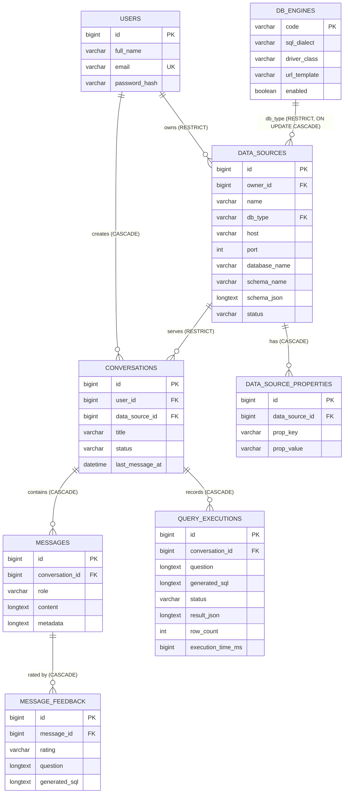

# Database ứng dụng và Flyway

DB ứng dụng là MySQL 8 (database `ai_agent`), schema được quản lý hoàn toàn bằng Flyway (`backend/ai_agent/src/main/resources/db/migration`). Hibernate chạy `ddl-auto: validate`, nghĩa là entity phải khớp schema do migration tạo ra; backend sẽ không khởi động nếu lệch.

> Đây là DB của **ứng dụng**. Database mà người dùng khai báo để hỏi đáp (data source) là hệ thống bên ngoài, chỉ được đọc qua JDBC.

## Mục lục

1. [Sơ đồ quan hệ](#1-sơ-đồ-quan-hệ)
2. [Chi tiết bảng](#2-chi-tiết-bảng)
3. [Trạng thái](#3-trạng-thái)
4. [Catalog `db_engines`](#4-catalog-db_engines)
5. [Định dạng schema snapshot](#5-định-dạng-schema-snapshot)
6. [Lịch sử migration](#6-lịch-sử-migration)
7. [Quy tắc viết migration](#7-quy-tắc-viết-migration)
8. [Xử lý sự cố Flyway](#8-xử-lý-sự-cố-flyway)

---

## 1. Sơ đồ quan hệ



Quy tắc xóa quan trọng:

- Không có `ON DELETE CASCADE` từ `data_sources` xuống `conversations` (V3 đã đổi sang `RESTRICT`); ứng dụng chỉ **archive** data source.
- Xóa user bị chặn nếu user còn data source (`fk_data_sources_owner ON DELETE RESTRICT`).
- Xóa conversation (chỉ xảy ra khi xóa thẳng trong DB) kéo theo messages, query executions và feedback.

---

## 2. Chi tiết bảng

Mọi timestamp là `DATETIME(6)` và do entity set qua `@PrePersist`/`@PreUpdate`.

### `users` (V2)

| Cột | Kiểu | Ghi chú |
|---|---|---|
| `id` | BIGINT PK AI | |
| `full_name` | VARCHAR(150) NOT NULL | |
| `email` | VARCHAR(255) NOT NULL | `uk_users_email` |
| `password_hash` | VARCHAR(255) NOT NULL | BCrypt |
| `created_at`, `updated_at` | DATETIME(6) NOT NULL | |

### `data_sources` (V1, V3, V7)

| Cột | Kiểu | Ghi chú |
|---|---|---|
| `id` | BIGINT PK AI | |
| `owner_id` | BIGINT NOT NULL | FK `users.id`, RESTRICT |
| `name` | VARCHAR(150) NOT NULL | `uk_data_sources_owner_name (owner_id, name)` |
| `db_type` | VARCHAR(30) NOT NULL | FK `db_engines.code` |
| `host` | VARCHAR(255) NOT NULL | |
| `port` | INT NOT NULL | |
| `database_name` | VARCHAR(255) NOT NULL | |
| `username` | VARCHAR(255) NOT NULL | |
| `password` | VARCHAR(500) NOT NULL | **Hiện là plain text**; chuỗi rỗng nếu không có |
| `schema_name` | VARCHAR(128) NULL | V7 |
| `ssl_enabled` | BOOLEAN NOT NULL DEFAULT FALSE | V7 |
| `connect_timeout_seconds` | INT NOT NULL DEFAULT 10 | V7 |
| `query_timeout_seconds` | INT NOT NULL DEFAULT 30 | V7 |
| `max_rows` | INT NOT NULL DEFAULT 1000 | V7 |
| `schema_json` | LONGTEXT NULL | Snapshot schema |
| `last_synced_at` | DATETIME(6) NULL | |
| `status` | VARCHAR(20) NOT NULL DEFAULT 'ACTIVE' | V3 |
| `last_connection_status` | VARCHAR(30) NULL | `SUCCESS` / `FAILED` |
| `last_connection_error` | TEXT NULL | Đã được làm sạch |
| `created_at`, `updated_at` | DATETIME(6) NOT NULL | |

### `data_source_properties` (V7)

| Cột | Kiểu | Ghi chú |
|---|---|---|
| `id` | BIGINT PK AI | |
| `data_source_id` | BIGINT NOT NULL | FK, CASCADE |
| `prop_key` | VARCHAR(100) NOT NULL | `uk_data_source_properties_key (data_source_id, prop_key)` |
| `prop_value` | VARCHAR(1000) NOT NULL | |
| `created_at`, `updated_at` | DATETIME(6) NOT NULL | |

### `conversations` (V1, V3, V4)

| Cột | Kiểu | Ghi chú |
|---|---|---|
| `id` | BIGINT PK AI | |
| `user_id` | BIGINT NOT NULL | FK `users.id`, CASCADE |
| `data_source_id` | BIGINT NOT NULL | FK `fk_conversations_data_source_restrict`, RESTRICT |
| `title` | VARCHAR(255) NOT NULL | |
| `status` | VARCHAR(20) NOT NULL DEFAULT 'ACTIVE' | V4 đổi tên từ `usstat` |
| `last_message_at` | DATETIME(6) NULL | |
| `created_at`, `updated_at` | DATETIME(6) NOT NULL | |

Index: `idx_conversations_user_updated (user_id, updated_at)`, `idx_conversations_data_source`, `idx_conversations_updated_at`.

### `messages` (V1, V5)

| Cột | Kiểu | Ghi chú |
|---|---|---|
| `id` | BIGINT PK AI | |
| `conversation_id` | BIGINT NOT NULL | FK, CASCADE |
| `role` | VARCHAR(20) NOT NULL | `USER`, `ASSISTANT`, `TOOL`, `SYSTEM` |
| `content` | LONGTEXT NOT NULL | |
| `metadata` | LONGTEXT NULL | JSON (V5) |
| `created_at` | DATETIME(6) NOT NULL | Append-only, không có `updated_at` |

Index: `idx_messages_conversation_created (conversation_id, created_at)`.

### `query_executions` (V1)

| Cột | Kiểu | Ghi chú |
|---|---|---|
| `id` | BIGINT PK AI | |
| `conversation_id` | BIGINT NOT NULL | FK, CASCADE |
| `question` | LONGTEXT NOT NULL | Câu hỏi gốc, hoặc chính SQL khi query thủ công không có câu hỏi |
| `generated_sql` | LONGTEXT NOT NULL | SQL đã validate (không có `;` cuối) |
| `status` | VARCHAR(20) NOT NULL | |
| `result_json` | LONGTEXT NULL | `{"columns":[...],"rows":[{...}],"rowLimit":N}` |
| `row_count` | INT NULL | |
| `execution_time_ms` | BIGINT NULL | `0` khi lấy từ cache |
| `error_message` | LONGTEXT NULL | ≤ 2000 ký tự |
| `created_at` | DATETIME(6) NOT NULL | |

Lưu ý: chỉ SQL cuối (`final`) và query thủ công được ghi vào bảng này; các query khám phá của tool `run_sql`/`sample_values` thì không (chúng được ghi trong message `TOOL`).

### `message_feedback` (V5)

| Cột | Kiểu | Ghi chú |
|---|---|---|
| `id` | BIGINT PK AI | |
| `message_id` | BIGINT NOT NULL | FK, CASCADE |
| `rating` | VARCHAR(8) NOT NULL | `UP` / `DOWN` |
| `correction` | LONGTEXT NULL | Ghi chú/sửa đổi của user |
| `question` | LONGTEXT NULL | Snapshot từ metadata message |
| `generated_sql` | LONGTEXT NULL | Snapshot từ metadata message |
| `created_at` | DATETIME(6) NOT NULL | |

Index `idx_message_feedback_rating_created (rating, created_at)` phục vụ truy vấn few-shot (5 bản ghi `UP` mới nhất theo data source).

### `db_engines` (V6) – xem [mục 4](#4-catalog-db_engines).

---

## 3. Trạng thái

| Đối tượng | Giá trị đang dùng | Dự kiến, chưa dùng |
|---|---|---|
| Data source `status` | `ACTIVE`, `ARCHIVED` | `CONNECTION_ERROR` (test thành công sẽ đưa về `ACTIVE`), `SYNCING` |
| Data source `last_connection_status` | `SUCCESS`, `FAILED` | |
| Conversation `status` | `ACTIVE`, `ARCHIVED` | |
| Query execution `status` | `GENERATED`, `RUNNING`, `SUCCESS`, `FAILED` | `GENERATING`, `BLOCKED` |
| Message `role` | `USER`, `ASSISTANT`, `TOOL` | `SYSTEM` |
| Feedback `rating` | `UP`, `DOWN` | |

Quy tắc theo trạng thái:

- Data source `ARCHIVED`: không tạo conversation, không sync schema, không chat/query; vẫn đọc được.
- Conversation `ARCHIVED`: không gửi message, không query; vẫn đọc được lịch sử.

---

## 4. Catalog `db_engines`

Cách backend kết nối tới mỗi loại database được lưu dưới dạng dữ liệu.

| Cột | Ý nghĩa |
|---|---|
| `code` (PK) | Mã engine, giá trị của `data_sources.db_type` |
| `display_name` | Tên hiển thị |
| `sql_dialect` | Gửi cho agent để sinh SQL đúng cú pháp |
| `driver_class` | Lớp JDBC driver (JAR phải có trong `pom.xml`) |
| `url_template` | Placeholder `{host}`, `{port}`, `{database}` |
| `default_port` | Port gợi ý trên form |
| `default_schema` | Schema mặc định khi đọc metadata (`public`, `dbo`, ...) |
| `identifier_quote_open` / `_close` | Ký tự quote identifier |
| `limit_style` | `LIMIT` (`... LIMIT n`), `TOP` (`SELECT TOP n ...`), `FETCH` (`... FETCH FIRST n ROWS ONLY`) |
| `schema_init_sql` | Câu chạy sau khi kết nối để chọn schema, placeholder `{schema}` |
| `default_properties` | Thuộc tính JDBC luôn áp dụng, dạng `k=v;k=v` |
| `ssl_properties` | Thuộc tính thêm khi bật SSL |
| `timeout_property` / `timeout_unit` | Tên thuộc tính connect timeout và đơn vị (`SECONDS`/`MILLISECONDS`) |
| `supports_schema` | Form có cho nhập schema không |
| `enabled` | Ẩn/hiện engine |
| `sort_order` | Thứ tự hiển thị |

Dữ liệu seed (V6):

| code | Dialect | Port | Quote | Limit | Chọn schema | Mặc định | SSL |
|---|---|---|---|---|---|---|---|
| `MYSQL` | MySQL | 3306 | `` ` `` | LIMIT | – | `sslMode=DISABLED;allowPublicKeyRetrieval=true;serverTimezone=UTC` | `sslMode=REQUIRED` |
| `MARIADB` | MariaDB | 3306 | `` ` `` | LIMIT | – | – | `sslMode=trust` |
| `POSTGRESQL` | PostgreSQL | 5432 | `"` | LIMIT | `SET search_path TO {schema}` | `ApplicationName=KLTN-AI-Agent` | `sslmode=require` |
| `SQLSERVER` | T-SQL (SQL Server) | 1433 | `[ ]` | TOP | – (dùng `schema.table`) | `encrypt=false;applicationName=KLTN-AI-Agent` | `encrypt=true;trustServerCertificate=true` |
| `ORACLE` | Oracle SQL | 1521 | `"` | FETCH | `ALTER SESSION SET CURRENT_SCHEMA = {schema}` | – | – |

Ví dụ điều chỉnh (nên viết thành migration mới nếu áp dụng cho môi trường dùng chung):

```sql
-- Đổi timezone mặc định của MySQL
UPDATE db_engines
SET default_properties = 'sslMode=DISABLED;allowPublicKeyRetrieval=true;serverTimezone=Asia/Ho_Chi_Minh'
WHERE code = 'MYSQL';

-- Tắt Oracle trên giao diện
UPDATE db_engines SET enabled = FALSE WHERE code = 'ORACLE';
```

Thêm engine mới: thêm dependency JDBC driver vào `backend/ai_agent/pom.xml`, rồi tạo migration `INSERT INTO db_engines (...)`.

---

## 5. Định dạng schema snapshot

`data_sources.schema_json` sau khi sync:

```json
{
  "database": "Rfam",
  "schema": null,
  "dialect": "MySQL",
  "tables": [
    {
      "name": "family",
      "type": "TABLE",
      "columns": [
        { "name": "rfam_acc", "type": "VARCHAR", "nullable": false },
        { "name": "num_full", "type": "INT", "nullable": true }
      ]
    }
  ]
}
```

- Lấy tối đa 500 bảng; loại `TABLE`, `VIEW`, `PARTITIONED TABLE`.
- `name` có dạng `schema.table` khi data source chỉ định schema khác mặc định và engine không có `schema_init_sql`.
- Khi gửi cho agent, backend rút gọn mỗi bảng còn `{name, columns: [tên cột]}`; tool `describe_table` trả đầy đủ kiểu và nullable.

---

## 6. Lịch sử migration

| Version | File | Nội dung |
|---|---|---|
| V1 | `V1__create_primary_tables.sql` | Tạo `data_sources`, `conversations`, `messages`, `query_executions` |
| V2 | `V2__create_users.sql` | Tạo `users` |
| V3 | `V3__alter_data_conversations.sql` | Thêm `owner_id`, `status`, thông tin kết nối cho data source; tên unique theo owner; thêm `user_id`, status (đặt nhầm tên `usstat`), `last_message_at` cho conversation; đổi FK data source → conversation sang `RESTRICT` với tên mới `fk_conversations_data_source_restrict` |
| V4 | `V4__rename_conversation_status.sql` | Đổi `usstat` → `status` |
| V5 | `V5__feedback_and_message_metadata.sql` | Thêm `messages.metadata`, tạo `message_feedback` |
| V6 | `V6__create_db_engines.sql` | Tạo và seed `db_engines` |
| V7 | `V7__data_source_connection_settings.sql` | Cấu hình kết nối theo data source, FK `db_type` → `db_engines`, tạo `data_source_properties` |

V3 giả định `data_sources` và `conversations` chưa có dữ liệu (thêm cột `NOT NULL` không có default). Nếu cần migrate dữ liệu cũ, phải viết migration riêng có chiến lược backfill rõ ràng, không đoán owner.

---

## 7. Quy tắc viết migration

1. **Không sửa** migration đã chạy trên DB dùng chung/production; luôn tạo version mới.
2. Tên `V<number>__<description>.sql` (hai dấu gạch dưới), version tăng dần, không trùng version. `validate-migration-naming: true` sẽ báo lỗi tên sai.
3. Mỗi migration phải chạy được trên schema do migration trước tạo ra.
4. Cập nhật migration **trước**, rồi mới sửa entity (vì `ddl-auto: validate`).
5. `FOREIGN KEY` phải nằm trong `CREATE TABLE` hoặc `ALTER TABLE`, không đứng riêng.
6. Khi đổi FK, drop và add trong hai câu `ALTER TABLE` riêng, dùng tên mới.
7. Dùng `DATETIME(6)` cho timestamp.
8. Không dùng `ON DELETE CASCADE` từ `data_sources` xuống `conversations`.
9. Test bằng `mvn clean test` **không** chạy Flyway (profile test dùng H2 + `create-drop`); phải chạy `mvn spring-boot:run` với MySQL thật để kiểm tra migration.

---

## 8. Xử lý sự cố Flyway

MySQL commit ngầm sau mỗi câu DDL, nên một migration fail giữa chừng có thể để lại thay đổi dở dang.

1. Đọc log: câu SQL và số dòng bị lỗi.
2. Xem lịch sử:
   ```sql
   SELECT installed_rank, version, description, success, checksum FROM flyway_schema_history ORDER BY installed_rank;
   ```
3. Xem schema thực tế: `SHOW CREATE TABLE <bảng>;`
4. Xác định migration đã chạy hết, chạy một phần hay chưa chạy.
5. Chọn cách xử lý:
   - **DB dev, không cần dữ liệu**: xóa và tạo lại (`docker compose down -v` hoặc `DROP DATABASE ai_agent; CREATE DATABASE ai_agent;`), rồi khởi động lại backend để chạy lại từ V1. Chỉ làm khi đã chắc chắn.
   - **Cần giữ dữ liệu**: hoàn tác thủ công phần đã chạy dở, sửa migration (nếu chưa từng chạy thành công ở nơi khác), chạy `flyway repair` để xóa bản ghi lỗi, rồi khởi động lại.
6. Không chạy `flyway clean` hay xóa volume khi chưa được xác nhận.

Ghi chú:

- Checksum âm trong `flyway_schema_history` là bình thường (số nguyên có dấu). Chỉ xử lý khi Flyway báo `checksum mismatch`.
- `BUILD SUCCESS` của Maven không có nghĩa app đã chạy được; Spring Boot vẫn có thể fail khi Flyway/Hibernate validate.
- Kết nối nhanh vào MySQL của Compose: `docker exec -it mysql_agent mysql -uroot -p1234 ai_agent`.
